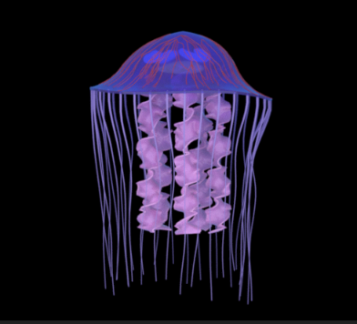

## Project Description

For this project, I created the procedural jellyfish in Houdini 22, focusing on procedural modeling, animation, and Vellum simulations. I built the bell using a revolved curve and animated it with Bend deformers, then added scalloped edges using VEX. For the arms, I used grids with procedural ruffles and twisting, along with Vellum Cloth to give them secondary motion. The tentacles were generated from points along the bell's rim and simulated using Vellum Hair. I also added procedural veins and internal organs that deform with the bell's animation. Finally, I used MaterialX and Karma XPU to shade and render the jellyfish, and cached the simulations to improve performance. In terms of art direction, I wanted the jellyfish to have longer tentacles and arms that flowed with the ripple of the bell, and a bell animation that suggested the jelly was really flexing the bell and pushing upwards in the water, including retracting the bell when it reaches the top of that push. Also, I had to adapt the arms to be much more stiff than in the tutorial, because the added height from the "push upwards" sometimes yanked the Vellum sim to the point where the arms became taut. Overall, I wanted to create a sense of vertical lines and motion.

## Final Videos

[jellyfish](https://vimeo.com/1237474215/8c0ec6bcc5?share=copy&fl=sv&fe=ci)
